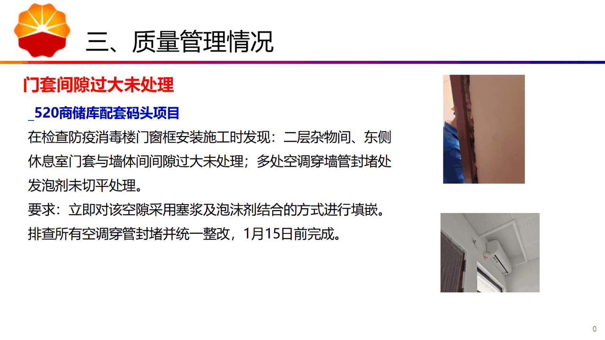
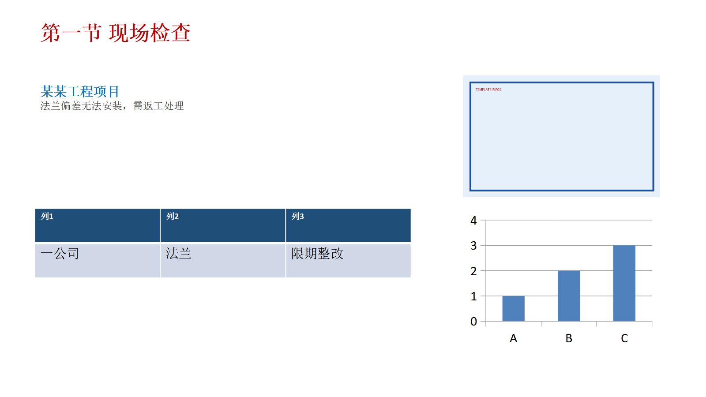
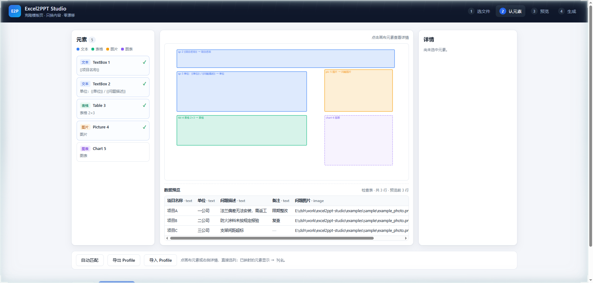
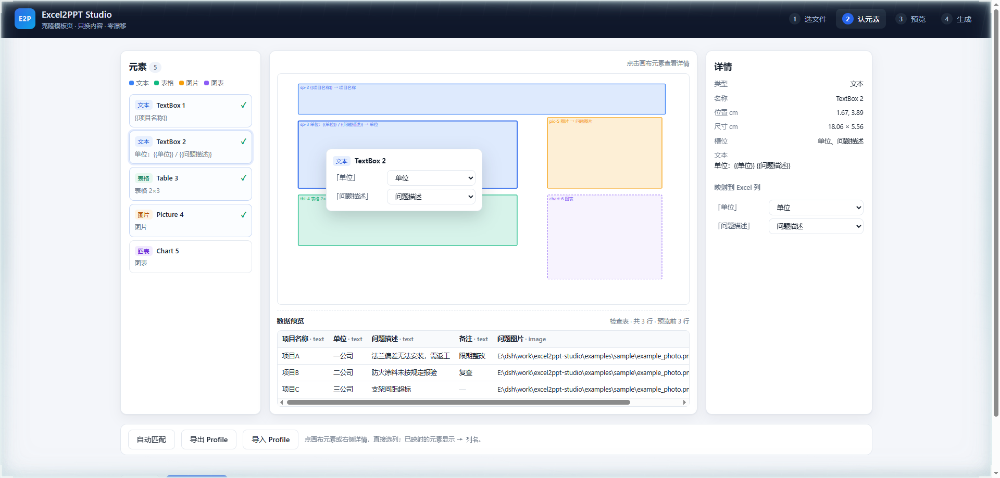
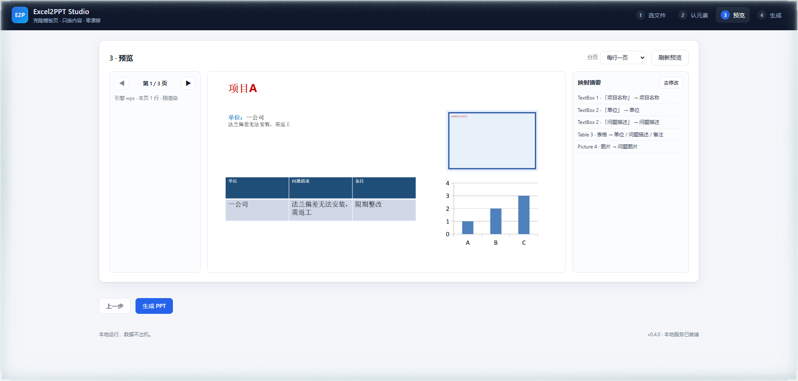
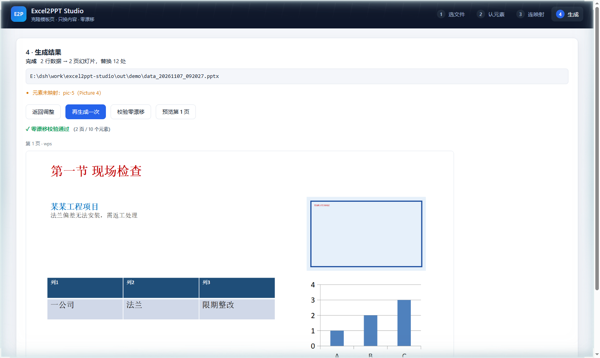

# Excel2PPT Studio

> 把 Excel 台账按「单页 PPT 模板」逐行生成多页幻灯片——**克隆母版页，只换内容**，排版、颜色、字体、位置零漂移。



[](https://www.python.org/)
[](LICENSE)
[](tests/)

---

## 为什么不是又一个「Excel 转 PPT」工具

大多数工具的做法是**新建**元素：读数据 → 创建文本框 → 设坐标 → 设字体。模板一换，坐标常量就失效；元素一多，版式就散。

本工具反其道而行：**把模板页整页克隆，再在克隆页里只替换文本节点**。格式属性（`a:rPr`）、段落属性（`a:pPr`）、位置（`a:xfrm`）、表格样式（`a:tcPr`）从头到尾没有被写入过——**不是"尽量保留"，是结构上不可能被改坏**。

| 维度 | 传统生成器 | Excel2PPT Studio |
|---|---|---|
| 元素来源 | 代码新建 | 模板页 XML 深拷贝 |
| 坐标 | 硬编码常量 | 原样继承 |
| 换模板 | 改代码 | 改映射（零代码） |
| 字体/颜色 | 代码指定 | 继承模板，零改动 |
| 图片 | 重新摆放 | 换 media 字节，保留裁剪/效果 |
| 校验 | 肉眼看 | 格式指纹逐 shape 比对 |

---

## 核心特性

| 能力 | 状态 |
|---|---|
| 模板元素自动提取与分类（文本/表格/图片/图表/组合） | ✅ v0.1 |
| 绝对坐标换算（含组合形状 `chOff/chExt`） | ✅ v0.1 |
| 槽位探测（`{{x}}` / `${x}` / 命名形状 / 替代文字） | ✅ v0.1 |
| 零漂移克隆渲染（文本·表格·图片） | ✅ v0.1 |
| Excel 表头校验、类型推断、WPS 内嵌图片提取 | ✅ v0.1 |
| 映射 Profile 存取与自动建议 | ✅ v0.1 |
| CLI：`inspect` / `suggest` / `build` / `web` | ✅ v0.1 |
| 可视化四步向导（画布 + 映射表 + 数据预览 + Profile 导入导出） | ✅ v0.2 |
| 就地映射：点画布元素直接选列（浮层 + 详情联动） | ✅ v0.5 |
| 段落级槽位：无占位符模板也能按段映射 | ✅ v0.5.1 |
| 真实预览：按页渲染 WPS 缩略图，翻页/切分页/缓存 | ✅ v0.5 |
| AI 短标题（`e2p titles` + `value_map` 覆盖） | ✅ v0.6 |
| 页码 / 总页数 / 生成日期变量 | ✅ v0.6 |
| 便携版：双击 exe 即用，目标机无需 Python | ✅ v0.6 |
| 格式指纹校验（逐 shape 比对，把零漂移变成断言） | ✅ v0.3 |
| WPS / PowerPoint 真实渲染预览（子进程隔离，失败降级） | ✅ v0.3 |
| 文本溢出估算与告警（只告警不改字号） | ✅ v0.3 |
| 图表数据绑定（保留类型/配色/坐标轴，同步内嵌工作簿） | ✅ v0.4 |
| 分页：每行一页 / 每 N 行一页 | ✅ v0.4 |
| DSH（DeepSeek Harness）插件：3 个模型工具 + 界面入口 | ✅ v0.4 |
| 打包 exe / pip 发布 | 🚧 M5 |
| DSH（DeepSeek Harness）插件封装 | 🚧 M4 |
| 打包 exe / pip 发布 | 🚧 M5 |

> 首版明确取舍：超长文本**只告警不改**（严格保真），字号缩放需显式开启。

### 实测效果

模板页（`{{...}}` 占位）克隆后逐行替换，字体、颜色、表格底纹、图片位置全部原样：



---

## 快速开始

### 方式一：装包（推荐）

```powershell
pip install excel2ppt-studio

# 图形界面：启动后自动打开浏览器
e2p web
```

### 方式二：便携版（不需要 Python）

下载 [最新 Release](https://github.com/grh-cb/excel2ppt-studio/releases/latest) 里的
`Excel2PPT-Studio-win64.zip`，解压后双击 `Excel2PPT-Studio.exe`，浏览器会自动打开。

### 方式三：开发安装

```powershell
git clone https://github.com/grh-cb/excel2ppt-studio.git
cd excel2ppt-studio
python -m pip install -e ".[dev,web]"

# 生成示例模板与数据（3 行台账 + 单页模板）
python examples/make_sample.py

e2p web
```

### 纯命令行

```powershell
e2p inspect "模板.pptx" --slide 1
e2p suggest --excel "台账.xlsx" --template "模板.pptx" --out profile.json
e2p build --excel "台账.xlsx" --template "模板.pptx" --profile profile.json --out "汇报.pptx"
```

### 界面

四步向导：**选文件 → 认元素 → 连映射 → 生成**。

**认元素（就地映射）**：点画布元素弹出列下拉，选完立刻显示在框上。

| 画布与详情 | 就地浮层 |
|---|---|
|  |  |

**预览**：按页渲染 WPS 真实缩略图，可翻页、切分页、看映射摘要。



生成后可一键「校验零漂移」与「预览第 1 页」：



- 点画布元素（或左侧清单）→ 右侧详情与浮层都能直接选列；已映射元素实线并显示 `→ 列名`。
- 表格按表头逐列映射；图片可选 contain / cover / stretch；图表分别选类目列与数值列。
- 预览按「页」渲染，与最终出片一致；无 WPS 时降级为几何预览并提示。
- Profile 可导出为 JSON，下次一键导入复用（也自动存浏览器本地）。
- 校验会逐 shape 比对位置、尺寸、字体签名，并列出残留占位符。

### 作为 DSH 插件

插件已发布到 npm（`dsh-excel2ppt-studio`），后端在 PyPI：

```powershell
pip install excel2ppt-studio
plugin_manager install_bundle target=dsh-excel2ppt-studio
```

也可以在 Harness 的 Plugins → Discover 里添加市场索引：

```text
https://grh-cb.github.io/excel2ppt-studio/market-index.json
```

安装后：

| 形态 | 内容 |
|---|---|
| Host 工具 | `excel2ppt_build`（按 Profile 生成）、`excel2ppt_inspect`（看模板元素）、`excel2ppt_verify`（零漂移校验） |
| Client 入口 | 输入框下方 `Excel2PPT` 按钮，打开本地 Studio |

配置项：`pythonPath`（解释器路径，默认 `python`）、`studioUrl`、`timeoutMs`，见 [dsh-plugin/README.md](dsh-plugin/README.md)。

---

## CLI

| 命令 | 作用 |
|---|---|
| `e2p inspect <template> [--slide N] [--json out.json]` | 输出模板元素清单：类型、角色、坐标（EMU/cm）、文本、槽位 |
| `e2p suggest --excel <xlsx> --template <pptx> [--out profile.json]` | 按「列名 ↔ 槽位名」相似度生成初始映射 |
| `e2p build --excel <xlsx> --template <pptx> --profile <json> --out <pptx>` | 逐行克隆生成，失败中文单行报错、非零退出 |
| `e2p web [--port 8765] [--no-browser]` | 启动本地四步向导 |
| `e2p verify --template <pptx> --output <pptx>` | 逐页比对模板与输出，报告位置/尺寸/字体差异 |

退出码：`0` 成功；`1` 业务失败（信息可读）；`2` 参数错误。

---

## 保真原理（技术）

1. **部件树深拷贝**：`SlidePart` 的 XML、图片、图表、内嵌工作簿按关系树递归复制，各自的 `rId` 重新映射。
2. **只改 `<a:t>`**：文本节点的兄弟属性（`a:rPr` 字号/加粗/颜色/字体、`a:pPr` 对齐/缩进、`a:bodyPr` 内边距）一律不写。
3. **三种替换粒度**：run 内子串（默认，最保真）→ 段落整体 → shape 整体（显式选择，会重置格式）。
4. **布局关系复用**：克隆页共享同一 `slideLayout`，模板改版式时全部生成页自动跟随。
5. **格式指纹校验**（M3）：归一化 XML（抹掉文本、rId、shape id）后与模板页逐 shape 同构比对，可机检。

详见 [ADR-0001](docs/adr/0001-clone-preserving-render.md) 与 [架构说明](docs/ARCHITECTURE.md)。

---

## 项目结构

```
src/excel2ppt_studio/
  core/
    model.py             # Field / Slot / Binding / Profile 数据模型
    slot_detect.py       # 槽位探测规则
    template_scanner.py  # 模板 → Field 列表
    excel_reader.py      # 表头校验 / 类型推断
    excel_images.py      # WPS DISPIMG 图片提取
    mapping.py           # 自动建议 + Profile 存取
    renderer.py          # 克隆 + 分页 + 后处理
    verifier.py          # 格式指纹校验
    preview.py           # WPS COM 预览（子进程隔离）
    text_fit.py          # 文本溢出估算
  web/                   # FastAPI 服务 + 四步向导（static/ 原生 HTML/CSS/JS）
  cli.py
examples/                # 示例模板/数据生成脚本
packaging/               # PyInstaller 打包
dsh-plugin/              # DeepSeek Harness 插件（Host 工具 + Client 入口）
tests/                   # pytest：fixtures 程序化生成，无二进制依赖
docs/                    # 架构、ADR、实施计划、发布指南
```

---

## 兼容性

| 项 | 说明 |
|---|---|
| Python | 3.10+（开发环境 3.13.2 实测） |
| 模板 | `.pptx`（OOXML）；建议 16:9，单页母版；多页模板需指定 `--slide` |
| 数据 | `.xlsx` / `.xlsm`；首行必须为表头 |
| 图片 | WPS「嵌入单元格」图片（DISPIMG）、本地路径、URL（需联网） |
| 办公软件 | WPS Office / Microsoft PowerPoint（预览能力依赖 WPS COM，可降级） |

---

## 路线图

| 里程碑 | 内容 | 状态 |
|---|---|---|
| M0 | 骨架 + 模板扫描器 + Excel 读取 + CLI 占位 | ✅ 已完成 |
| M1 | 克隆引擎 + 文本/表格/图片替换 + pytest | ✅ 已完成 |
| M2 | Web GUI 四步向导 + 画布映射 + Profile | ✅ 已完成 |
| M3 | WPS 预览 + 格式指纹 + 溢出告警 | ✅ 已完成 |
| M4 | 图表绑定 + 分页 + DSH 插件封装 | ✅ 已完成 |
| M5 | 打包、文档、发布准备 | ✅ 已完成 |

详见 [docs/PLAN.md](docs/PLAN.md) 与 [docs/PUBLISHING.md](docs/PUBLISHING.md)（发布清单、GitHub/PyPI/exe 步骤）。

---

## 贡献

见 [CONTRIBUTING.md](CONTRIBUTING.md)。提交前请确保 `pytest` 与 `ruff check` 通过。

## 许可证

[MIT](LICENSE) © 2026 一片风干叶
